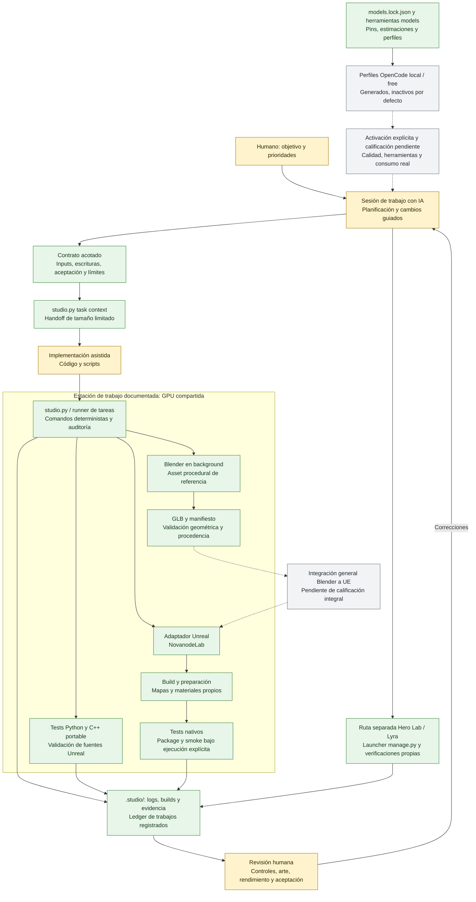
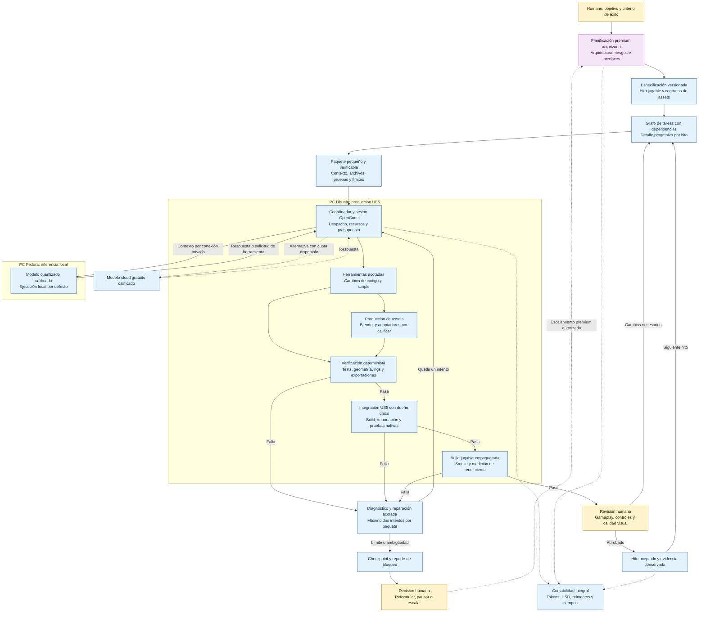

# Novanode Studio: pipeline actual y propuesta futura

**Fecha:** 2026-11-07 · **Plataforma principal:** Unreal Engine 5 / Linux.

**Continuación práctica:** [piloto de dos hosts](TWO_HOST_PILOT.md), con inventario
de solo lectura, comparación de snapshots y paquetes de ejecución con dependencias.

## Resumen

Hoy tenemos una base de estudio con contratos de trabajo, herramientas de assets,
adaptadores de Unreal, verificaciones y registros de ejecución. La coordinación entre
objetivos, sesiones de IA y herramientas sigue dependiendo de intervención explícita.

La propuesta es evolucionar hacia un estudio **local-first con dos PCs**: una dedicada
principalmente a UE5 y otra a inferencia. Los modelos premium ayudan a definir la
arquitectura y resolver bloqueos; los locales ejecutan paquetes pequeños y verificables.

**Objetivo de uso:** al menos 95% de los tokens en modelos locales o gratuitos y como
máximo 5% en modelos premium, medido por proyecto o período. Es una meta a validar,
no una capacidad ya demostrada ni una distribución equivalente del gasto monetario.

## 1. Pipeline actual

El gráfico representa las capacidades y conexiones documentadas en el repositorio.
Que exista un comando no significa que su ejecución nativa o su resultado visual estén
verificados para la revisión actual. Las flechas punteadas señalan conexiones opcionales
o pendientes; las continuas muestran el recorrido operativo, con sus pasos manuales.

**Lectura de colores:** verde = herramienta disponible; amarillo = intervención humana
o asistida; gris = activación o calificación pendiente. Verde no significa aprobación humana.

### Qué existe y dónde están los límites

| Área | Estado documentado |
|---|---|
| Contratos | Objetivo, inputs, escrituras permitidas, aceptación, intentos, tiempos y presupuesto. |
| Ejecución | El runner ejecuta comandos y audita escrituras; no es un sandbox ni un coordinador automático de modelos. |
| Unreal | NovanodeLab es el proyecto por defecto; Hero Lab/Lyra tiene una ruta específica. Hay comprobaciones históricas, no una aprobación global del estado actual. |
| Assets | Hay generación procedural con Blender y validación de GLB/manifiesto. El ejemplo de banco escribe en el árbol del piloto legacy; no prueba una cadena general de importación a UE. |
| Modelos | Hay candidatos y perfiles preparados. La calidad de la cuantización real y el ciclo de herramientas necesitan benchmarks. |
| Recursos | La documentación de modelos contempla compartir una 3090 con Unreal. No acredita un coordinador operativo entre dos PCs. |
| Costos | El ledger cubre trabajos registrados, no todas las solicitudes realizadas desde OpenCode. |
| Aceptación | Tests, ejecución nativa y revisión visual/jugable son verificaciones distintas. |

En `studio.toml` figuran USD 25 de presupuesto local total y USD 5 por tarea,
sin adaptador pago habilitado. Esos valores **no son un límite mensual integral de
consumo de IA**, ni establecen todavía la política 95/5.

## 2. Pipeline futuro propuesto

**Estado: diseño propuesto.** La distribución siguiente es un punto de partida;
conservaremos la instalación funcional actual hasta validar cada traslado de responsabilidad.

| Equipo | Hardware informado | Responsabilidad principal propuesta |
|---|---|---|
| Ubuntu | Intel Core i7 de 11.ª generación, 64 GB RAM, RTX 3090 de 24 GB | UE5, integración de assets, compilación, pruebas jugables y empaquetado. |
| Fedora | AMD Ryzen 7 5700G, 64 GB RAM, RTX 3090 de 24 GB | Servicio de inferencia local y trabajos auxiliares programados según recursos. |

Las dos GPUs siguen siendo **dos espacios de 24 GB independientes**. La prioridad es
separar render e inferencia. El tamaño del modelo se elige midiendo pesos, caché de
contexto, buffers, latencia y fiabilidad de herramientas en una GPU.

**Lectura:** azul = componente o integración de la arquitectura objetivo;
violeta = uso selectivo premium; amarillo = decisión humana. Algunas piezas azules
reutilizan herramientas existentes, pero la cadena completa todavía debe implementarse.
Las flechas punteadas indican rutas opcionales o registro transversal.

La ubicación del coordinador es lógica: OpenCode opera sobre el proyecto y las
herramientas; Fedora devuelve inferencia. El modelo no necesita controlar directamente
el editor remoto. Empezamos con una tarea de código activa y una cola explícita;
dos PCs no implican un enjambre de agentes ni edición simultánea de escenas.

### Qué debe producir la planificación premium

1. **Objetivo y primer hito jugable:** resultado visible, alcance y criterios de éxito.
2. **Arquitectura:** interfaces, propietarios de sistemas y decisiones importantes.
3. **Contratos de assets:** escala, pivotes, esqueletos, materiales, nombres y presupuestos.
4. **Dependencias:** qué tarea desbloquea a cuál y cuándo se integra el resultado.
5. **Paquetes ejecutables:** contexto mínimo, archivos autorizados, resultado y verificación.
6. **Incertidumbres:** experimentos necesarios antes de comprometer una implementación.

Descomponer «hasta el átomo» significa llegar a **un resultado comprobable con pocas
decisiones abiertas**. No significa prescribir cada línea ni intentar anticipar todo el
proyecto. El detalle se actualiza después de cada hito, a partir de evidencia real.

### Contrato mínimo de cada paquete local

| Campo | Contenido esperado |
|---|---|
| Identidad y base | ID de tarea, revisión del proyecto y dependencias satisfechas. |
| Objetivo | Un resultado concreto, con ejemplo de comportamiento esperado. |
| Contexto | Archivos relevantes, interfaces existentes y un ejemplo funcional cuando exista. |
| Escrituras | Archivos y assets que ese trabajo puede modificar. |
| Aceptación | Condiciones observables, incluyendo los casos negativos importantes. |
| Verificación | Comandos, comprobaciones de runtime y evidencia visual cuando corresponda. |
| Límites | Contexto/tokens, tiempo, intentos, recursos y gasto permitido. |
| Salida | Cambios, evidencia, defectos pendientes y próximo paso. |
| Bloqueo | Error exacto, hipótesis probadas e información faltante; luego detenerse o escalar. |

Los estados conservan el contrato del estudio:
**`implemented` → `machine_verified` → `human_approved`**.
Solo una persona concede el último estado.

## 3. Contraste directo

| Dimensión | Actual | Futuro propuesto |
|---|---|---|
| Planificación | Humano y sesión de IA preparan el trabajo. | Premium define arquitectura y el próximo hito; se mantiene una especificación versionada. |
| Descomposición | Contratos individuales escritos explícitamente. | Grafo de dependencias y paquetes derivados del hito, revisados antes de ejecutar. |
| Coordinación | CLI y runner para comandos; elección de modelo separada. | Coordinador que conecta cola, sesión, inferencia, recursos y contabilidad. |
| GPU | Diseño documentado alrededor de una GPU compartida. | UE5 e inferencia tienen GPUs dedicadas en PCs distintas. |
| Modelos | Perfiles preparados y candidatos sin calidad local demostrada. | Modelos promovidos según resultados en tareas reales y cuantización exacta. |
| Cloud gratuito | Perfiles opcionales; capacidad y transporte por validar. | Complemento con cuota, disponibilidad y política de datos verificadas. |
| Premium | No hay un circuito integral con medición 95/5. | Planificación, bloqueos y revisión de hitos con límite monetario explícito. |
| Assets | Ejemplo procedural y validadores disponibles. | Brief → fuente → exportación → validación → importación UE → revisión. |
| Recuperación | Límites y checkpoints de tareas. | Reparación acotada, reporte de bloqueo y escalamiento con evidencia. |
| Aceptación | Comprobaciones parciales y gates humanos independientes. | Cada hito atraviesa la cadena completa, manteniendo esos gates. |

## 4. Cómo medir el objetivo 95/5

- **Tokens:** registrar entrada y salida por proveedor/modelo; incluir planificación,
  reintentos, resúmenes y solicitudes auxiliares. Reportar razonamiento y caché según
  lo que exponga cada proveedor, sin contarlos dos veces; marcar lo desconocido.
- **Proporción:** `(tokens locales + tokens gratuitos) / tokens totales` como indicador
  aproximado, ya que los tokenizadores difieren. Separar también local y gratuito.
- **Dinero:** techo mensual premium en USD, todavía por definir. El 5% de tokens no
  determina el porcentaje de costo; el cómputo local también consume energía.
- **Resultado:** tareas aceptadas sin premium, tiempo por entrega, reparaciones y
  correcciones humanas. No aumentar tokens locales solo para mejorar la proporción.
- **Escalamiento:** reservar capacidad premium para bloqueos y revisión, además del
  documento inicial. La falta de cuota gratuita no activa gasto pago automáticamente.

## 5. Transición por etapas

| Etapa | Entregable | Criterio para avanzar |
|---|---|---|
| 1. Línea base | Inventario de ambos equipos, engine, almacenamiento, red y servicios activos. | Roles acordados y proyecto jugable actual preservado. |
| 2. Inferencia separada | Servicio local en Fedora accesible desde la estación de trabajo por conexión privada. | Identidad del modelo, herramientas, contexto y VRAM medidos. |
| 3. Benchmark de trabajo | Comparación de un candidato pequeño y uno mayor sobre las mismas tareas. | Resultados reproducibles de corrección, latencia y reparación. |
| 4. Primer hito | Una función jugable con un asset y aproximadamente 10–20 paquetes. | Dependencias, aceptación y verificaciones explícitas. |
| 5. Ejecución instrumentada | Cola simple, registro de solicitudes y límites conectados al ciclo real. | Consumo y reintentos conciliados; bloqueos no generan bucles ilimitados. |
| 6. Cierre integral | Build empaquetada, evidencia y playtest. | Verificación técnica y aprobación humana del hito. |
| 7. Ampliación | Más tipos de assets y tareas según resultados. | La calidad y el costo por entrega justifican ampliar la automatización. |

**Decisiones abiertas:** identificar exactamente las herramientas llamadas «Maya» y
«Colibri», acordar el techo premium mensual y confirmar conectividad/almacenamiento
de ambas PCs. Sus adaptadores no se consideran integraciones actuales.

## Referencias del estado actual

- [README del proyecto](../README.md): capacidades, estado histórico y límites.
- [Configuración del estudio](../studio.toml): proyectos, engine y presupuesto local.
- [Contrato de assets](../tasks/asset-bench.json): generación y validación del ejemplo.
- [Contrato de smoke Unreal](../tasks/unreal-smoke.json): alcance de verificaciones nativas.
- [Revisión de arquitectura IA](AI_CODING_RESEARCH.md): antecedentes y brechas de calificación.
- [Roadmap de ejecución](EXECUTION_ROADMAP.md): plan operativo existente.

Este documento compara arquitectura y propone una evolución. No activa proveedores,
no mueve instalaciones y no acredita por sí mismo el funcionamiento del pipeline futuro.
